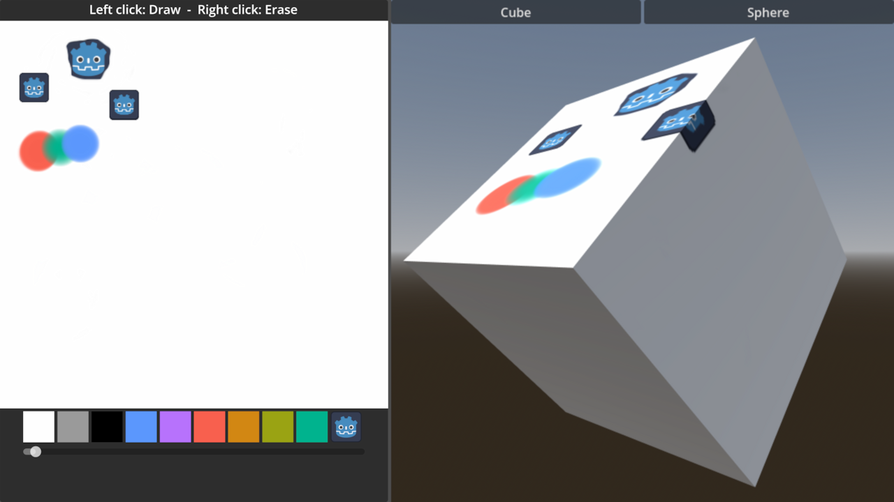
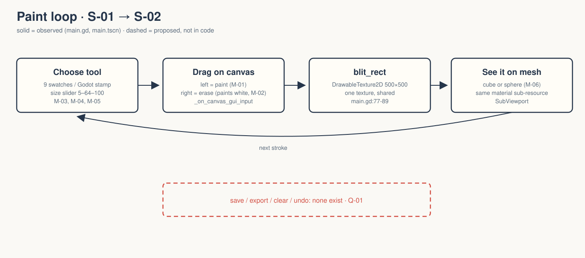

# walker-2d-drawable-textures: Game Design Document (recovered)

| | |
|---|---|
| Version | 0.1.0-recovered |
| Date | 2026-09-27 |
| Author | Zelda (agent, silent), for Nik Bear Brown |
| Mode | recovered · `/gdd reverse --path godot silent` |
| Revision | 1 |
| Gates | vision ○ · systems ○ · world ○ · scope ○. Gate unsigned at time of writing |
| Classification | **Tech demo, not a game.** A paint toy showing `DrawableTexture2D`, mirrored onto a 3D cube or sphere. No goal or end. |

Provenance tags: `[OBSERVED path:line]` · `[INFERRED]` with evidence · `[MISSING]`. Paths are relative to `godot/` unless they start with the folder root. A recovered GDD describes what exists. It approves none of it.

*`godot/screenshots/screenshot.webp`, shipped upstream and referenced by `godot/README.md:17`. This is design art, not a Walker capture. `FRICTIONAL.md:20-22` says no paint or erase pixels have been verified.*

## 1. Vision summary

**What it is.** "A simple demo in which you can paint using a DrawableTexture." The same texture is copied to a sphere and a cube mesh "to give a better example of how it can be used in-game" `[OBSERVED godot/README.md:3-7]`.

**Player fantasy / target player.** `[MISSING]` `[INFERRED]` The audience is Godot learners exploring runtime texture painting. The evidence: the code comments explain each API step (`main.gd:28-30,76-89`).

**Biggest unresolved question.** Does Walker want a creative toy (save or export drawings) or strictly an API demonstration? Q-01.

## 2. Design pillars

`[MISSING]` None stated. `[INFERRED]` One principle is visible: *one texture, many surfaces*. The canvas and the 3D material share one `DrawableTexture2D` (`main.gd:34-35`), and the cube and sphere share one material sub-resource (`main.tscn:176,182`).

## 3. Core loop

**Micro.** Choose a swatch or the Godot stamp, set a size, drag on the canvas with the left button (paint) or right button (erase), and watch the mesh update `[OBSERVED main.gd:68-89; main.tscn:187-190]`.
**Meso / macro.** `[MISSING]` No save, clear, undo, prompt or completion exists `[OBSERVED absence in main.gd]`.
**Loop honesty test.** There is a creative choice (colour, size, stroke) but no stakes and no reward beyond the picture. It is a toy loop, not a game loop.

## 4. Player Experience Goals

`[MISSING]` None authored. Candidate, `[INFERRED]`: PX-01, "the user sees a 2D stroke appear on a 3D surface immediately". Evidence: the shared texture and the side-by-side layout (`main.tscn:46-148`). Not approved.

## 5. Mechanics

### M-01 Paint `[OBSERVED main.gd:68-84]`
On mouse motion or a button event over the Canvas, holding the left button calls `blit_rect` with the brush, centred on the cursor. The canvas is 500×500 RGBA8 (`main.gd:31-32`). The brush is a radial `GradientTexture2D`: solid colour at the centre, fading to transparent (`main.gd:38-46`).

### M-02 Erase `[OBSERVED main.gd:48-56,72-73]`
Holding the right button blits an "eraser" gradient in `background_color` (white, line 21). It paints white. It does not restore transparency. `[INFERRED]` This fakes erasure only on a white canvas. The source comment says so: "to fake the erasing effect" (line 48-49).

### M-03 Colour swatches `[OBSERVED main.gd:62-64,94-100; main.tscn:78-120]`
Nine ColorRects. A left click sets the brush gradient to that colour and switches the mode to CIRCLE. ColorRect1 keeps the default white `[INFERRED no color line at main.tscn:78-80]`, which is the same as the eraser colour.

### M-04 Godot stamp `[OBSERVED main.gd:58,65,86-89,103-107]`
Clicking the logo sets `BrushMode.GODOT_LOGO`, and painting then blits `icon_brush.svg`. Erasing in stamp mode still uses the round eraser.

### M-05 Brush size `[OBSERVED main.gd:60,111-116; main.tscn:128-133]`
An HSlider with min 5 and value 64 sets the brush and eraser width and height. A focused End/Home sets 100/5 (verified, `FRICTIONAL.md:15-17`). `[INFERRED]` The maximum is Godot's default slider max of 100.

### M-06 Mesh preview `[OBSERVED main.gd:120-127; main.tscn:135-185]`
A SubViewport shows a cube (visible) or a sphere (hidden), switched by the Cube and Sphere buttons.

## 6. Systems

| ID | System | Owner | Evidence |
|---|---|---|---|
| S-01 | Drawable canvas + blit | `Main` Control + `main.gd` | `[OBSERVED]` |
| S-02 | 3D preview viewport | `SubViewportContainer/SubViewport` | `[OBSERVED main.tscn:135-185]` |

No save/load, no audio and no scene changes. No `[input]` actions (raw mouse only) `[OBSERVED project.godot]`. 3D physics is set to "Dummy" (`project.godot:30`).

## 7. Progression

`[MISSING]` None.

## 8. World

`[OBSERVED]` A two-pane UI: a drawing panel on the left, a 3D preview with a procedural sky on the right (`main.tscn:20-29,46-185`). `[MISSING]` Setting.

## 9. Narrative

`[MISSING]` None. The only text is "Left click: Draw  -  Right click: Erase" (`main.tscn:63`).

## 10. Characters

`[MISSING]` None.

## 11. Features and priority

| ID | Feature | State | Evidence |
|---|---|---|---|
| F-01 | Shared texture on canvas + both meshes | headless-verified | `brush-20260924.log` |
| F-02 | Swatches (9) + stamp select | headless-verified via GUI clicks | same |
| F-03 | Brush size via slider keys | headless-verified 100/5 | same |
| F-04 | Cube/Sphere toggle | headless-verified via focused Enter | same |
| F-05 | Actual paint / erase pixels, clipping, mesh appearance | **unverified** | `FRICTIONAL.md:20-22` |

CORE percentage: not computed `[MISSING MVP]`.

## 12. Out of scope

`[OBSERVED absence]` Undo, clear, save/export, layers, pressure. `README.md:8-10` lists what remains pending.

## 13. Technical

Godot 4.7, Compatibility renderer (`project.godot:18,35-36`), with `d3d12` selected for Windows RenderingDevice (`:34`). Low-processor mode (`:19`). VSync off (`:26`). 3D physics set to Dummy (`:30`). Main scene `res://main.tscn`. The SubViewport uses MSAA 3D level 2, scaling 2.0 and anisotropic level 4 (`main.tscn:142-148`). `main.gd` exports six node references (lines 8-14). Test: `test_brush.gd`, 17 checks.

## 14. Risks

| ID | Risk | Evidence |
|---|---|---|
| R-01 | "Erase" paints white. On any non-white background it would be visibly wrong | `main.gd:48-56` |
| R-02 | Headless state taken as proof of painting | `FRICTIONAL.md:20-22` |
| R-03 | A stamp at canvas edges: clipping is unverified | `README.md:9` |

## 15. Open questions

See `design/decisions.md`: Q-01 through Q-05.

## 16. Tests

Existing: `test_brush.gd`, 17 checks (`brush-20260924.log`). The earlier 15-check run is kept in `brush-before-20260924.log`. It disproved a suspected slider-initialisation bug, so no fix was needed.
Proposed (dashed): T-01 a GPU read-back of canvas pixels after one scripted stroke. T-02 erase over a coloured stroke returns white. T-03 a stamp at the canvas corner clips without error. H-01 a person paints for one minute and says what the demo shows.

## Zelda's notes (silent mode; what I would have said out loud)

- **Ghost Center, expected.** A paint toy with no reason to paint. That's fine for an API demo. Say "demo".
- **The eraser is a white brush.** Not a bug in a white-canvas demo, but it's the first thing anyone extending this will trip on. It's logged as R-01 so nobody narrates "erase" as "restore transparency."
- **The good design move is the shared texture.** Paint in 2D, see it in 3D, instantly. If there's a film, that's the shot.
